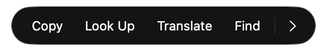

<p align="center">
  
</p>

<h1 align="center">GlassSelect</h1>

<p align="center">
  <strong>Native macOS 26 Liquid Glass Text-Selection Action Bar</strong><br/>
  A floating Liquid Glass action pill and expandable context menu triggered automatically on text selection across macOS apps.
</p>

<p align="center">
  
  
</p>

<p align="center">
  
</p>

---

> [!NOTE]
> **AI-Generated Tool Disclosure**
> **GlassSelect** (including its SwiftUI/AppKit Liquid Glass pill, Accessibility selection monitor, and on-device Apple `Translation` integration) is an **AI-generated tool** created with **Antigravity** (Google DeepMind).

---

## Features

- **Compact Liquid Glass Pill:** `Copy`, `Look Up`, `Translate`, `Find`, and `>` (or right-click to expand).
- **Expanded Context Menu:**
  - **Open Link:** Opens selected URLs directly.
  - **Look Up:** Inline dictionary definition via `CoreServices` + Dictionary.app.
  - **Translate:** On-device Apple `Translation` framework with target language picker.
  - **Find & Search:** Populates the macOS Find pasteboard (`⌘F`) or searches with Google, DuckDuckGo, Bing, or Naver.
  - **Speak & Spell:** Speech synthesis and language detection via `AVSpeechSynthesizer` + `NLLanguageRecognizer`.
  - **Copy Link with Highlight:** Generates `#:~:text=` links for Safari, Chrome, Arc, Brave, and Edge.
  - **Share & Quick Note:** Native `NSSharingServicePicker` and Apple Notes integration.

## Installation

### Build from Source
```zsh
git clone https://github.com/passs0/GlassSelect.git && cd GlassSelect
./scripts/build_app.sh
open build/GlassSelect.app
```

> **Permissions:** Grant **Accessibility** permission in **System Settings → Privacy & Security → Accessibility** so GlassSelect can detect text selections across apps. You can also trigger it anytime with `⌥ Space` or `⌘⇧E`.
