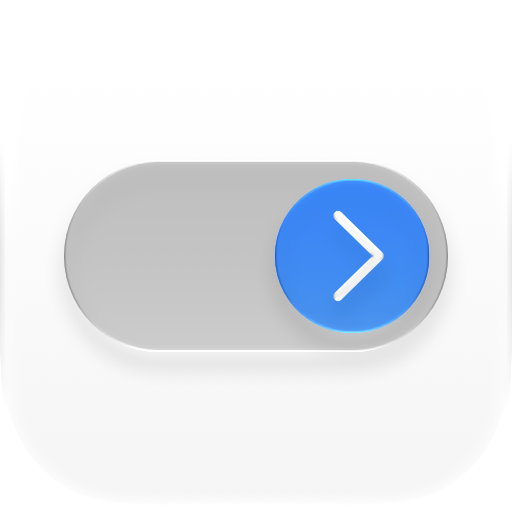
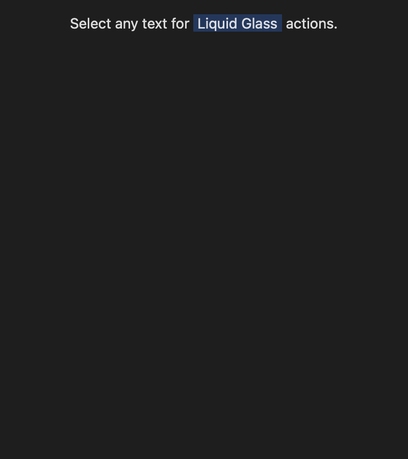

<p align="center">
  
</p>

<h1 align="center">Callout</h1>

<p align="center">
  A macOS 26 floating text-selection bar and context menu that appears right where you select text.
</p>

<p align="center">
  <a href="https://github.com/passs0/Callout/releases/latest"></a>
  
  <a href="LICENSE"></a>
</p>

<p align="center">
  
</p>

---

## What it does

- **Quick action pill:** Shows `Copy`, `Look Up`, `Translate`, `Find`, and `>` on text selection.
- **Native app context menu:** Clicking `>` (or right-clicking the pill) dismisses the pill and opens the active app's real macOS right-click context menu directly on your selection.
- **On-device translation:** Uses Apple's `Translation` framework with configurable target language in Settings.
- **Shortcuts:** Trigger manually anytime with `⌥ Space` or `⌘⇧E`.

## Install

Download **`Callout-1.0.2.dmg`** from [Releases](https://github.com/passs0/Callout/releases/latest) and drag `Callout.app` to `/Applications`.

Grant **Accessibility** permission in **System Settings → Privacy & Security → Accessibility** so Callout can read selected text across apps.

Or build from source:
```zsh
git clone https://github.com/passs0/Callout.git && cd Callout
./scripts/build_app.sh
open build/Callout.app
```

Built with [Google Antigravity](https://antigravity.google) — 100% AI-written code and UI, steered and tested by hand.

## License

[MIT](LICENSE)
